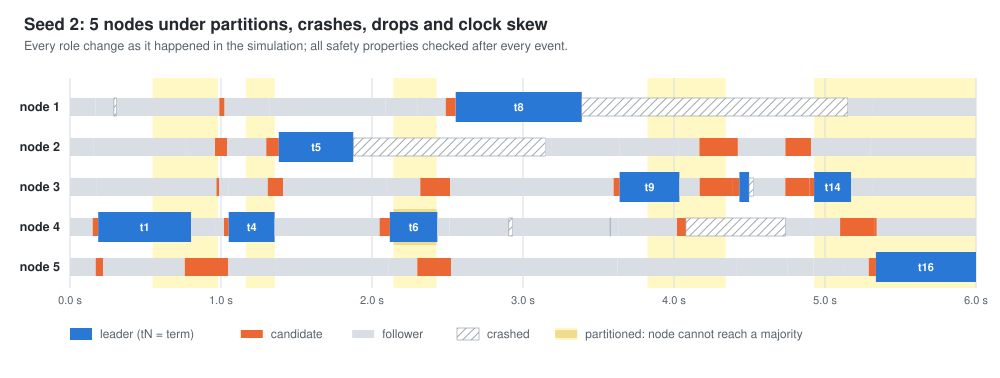

# quorum-lab

[](https://github.com/ahmed-hashim-pro/quorum-lab/actions/workflows/ci.yml) [](LICENSE)

Raft, written from scratch, and a deterministic simulator that attacks it.
The simulator partitions the network, crashes and restarts nodes, drops,
duplicates and reorders messages, and runs each node's clock at its own rate.
After every event it checks Raft's safety properties. At the end of each run
it checks that clients saw a linearizable store, and that all their work
finished once the faults stopped.

A distributed system rarely fails on the happy path. It fails when a leader
dies halfway through replicating an entry, or a node restarts holding a vote
it should have remembered, or a message turns up a second after it stopped
being true. These interleavings are rare, which is why ordinary tests miss
them. The simulator explores millions of them, and every run is a pure
function of its seed, so any failure it finds replays exactly.

**A clean run only means something if the checker would have noticed a
broken one.** So the repository also carries six known ways to get Raft
wrong, each behind a switch, and the simulator has to catch every one:

```
$ quorumlab mutants
variant                  result      first seed   caught as
correct build            clean       -            5000 seeds, no violation
vote-without-log-check   caught      1            leader completeness
commit-previous-term     caught      258          leader completeness
forget-vote              caught      674          election safety
keep-conflicts           caught      1            state machine safety
accept-stale-term        caught      6            leader completeness
no-dedup                 caught      2            linearizability
```

The correct build also runs 20,000 seeds with no violation on every push.


*`quorumlab run --seed 258 --bug commit-previous-term --svg docs/figure8.svg`.
This is Figure 8 of the Raft paper, found by random search. The leader of
term 50 counts replicas of the term-19 leader's entry at index 52 and calls
it committed. Node 2, holding the term-20 leader's entry at that index, then
wins term 51 and would overwrite it. Correct Raft never counts replicas of
an earlier term's entry (§5.4.2), and this is the failure that rule
prevents.*


## Quickstart

You need Go 1.22 or newer. There are no dependencies outside the standard
library.

```bash
git clone https://github.com/ahmed-hashim-pro/quorum-lab && cd quorum-lab
go build -o quorumlab ./cmd/quorumlab

./quorumlab run --seed 2                       # one run, summarised
./quorumlab run --seed 2 --trace               # every election, fault and restart
./quorumlab run --seed 2 --svg timeline.svg    # the picture below
./quorumlab hunt --seeds 2000                  # many seeds, on every core
./quorumlab bugs                               # the six deliberate bugs
./quorumlab hunt --bug forget-vote --seeds 1000
./quorumlab mutants                            # the table above
```

`go test ./...` runs the whole suite in about 15 seconds. `make check` adds
the full 20,000-seed hunt and the mutant table, as CI does.



*Seed 2, the correct build. Each lane is one node. Yellow bands are
partitions, and a darker lane inside one marks a node that couldn't reach a
majority.*

## What is in it

```
raft/   Raft as a pure state machine: Tick, Step, Propose in; Ready out
kv/     the replicated key-value store, with client sessions
sim/    the simulator, the safety checker, the fault profiles, the bugs
linz/   a linearizability checker for the client history
cmd/    the quorumlab CLI
```

### Raft with no goroutines and no clock

`raft.Node` doesn't send anything, sleep, or read the time. Time arrives as
`Tick()`, messages as `Step(m)`, and client commands as `Propose(data)`.
Everything the node wants done comes back from `Ready()`: state to persist,
messages to send, committed entries to apply. The driver must persist before
it sends. That's the whole contract, and it's what makes the node testable.
The same code runs under the simulator and under a hand-driven harness in
the unit tests, which replay the paper's scenarios message by message.

It implements:

- leader election, with randomised timeouts and retried vote requests
- log replication, with back-off on mismatch and a cap on entries per message
- the commit rule, which counts replicas only for entries of the leader's own
  term (the leader appends a no-op when it takes office)
- durable term, vote and log

It doesn't implement membership changes, snapshots, PreVote or leader
leases. See [What this does not do](#what-this-does-not-do).

### The simulator

One event queue and one virtual clock, which jumps from event to event:

- **Ticks.** Each node ticks at its own rate. The period is skewed by up to
  ±50% and redrawn on every restart.
- **The network.** Every message gets a random delay. A slow path, taken 5%
  of the time, lets later traffic overtake it. Messages can also be dropped or
  duplicated.
- **Partitions** come in four shapes:
  - one node isolated
  - a random clean split
  - a *bridge*: two halves that can only reach each other through one node
  - a *ring*: each node reaches only its two neighbours

  The last two aren't transitive, and they matter. A bridge node hears
  candidates on both sides that can't hear each other, so it can vote in both
  elections. Two of the six bugs went uncaught in 5,000 seeds until these
  shapes were added.
- **Crashes and restarts.** A crash loses everything except what was
  persisted. Half the crashes *bounce*: the process restarts within 30 ms, as
  under a supervisor. Half of all crashes and isolations aim at the current
  leader, since a leader's last moments are where most of the danger is.
- **Clients.** Four clients each run 60 commands (get, put, append) on three
  keys. They retry with the same sequence number when a reply doesn't come,
  and they follow leader hints.

Each seed also draws its own **fault profile**. That covers how lossy the
network is, how often faults strike, how skewed the clocks are, how many
entries fit in one message, and how short election timeouts are relative to
message delay. This is swarm testing: a run that's very lossy but rarely
partitioned reaches different corners from one that's the other way round.
A uniform mix of everything reaches neither.

After 10 simulated seconds, the chaos phase ends. The network heals and
becomes fast, every node comes back, and the clients get 10 more seconds to
finish.

### What is checked

After **every event**, on the live cluster:

| Property | Checked as |
|---|---|
| Election Safety | at most one leader per term, ever |
| Log Matching | if two durable logs share an entry's index and term, they're identical up to it |
| Leader Completeness | a new leader of term T holds every entry committed in a term before T |
| State Machine Safety | no two nodes ever apply different entries at the same index |
| Monotonicity | durable terms never go back; a node's commit index never goes back while it runs |
| No panics | a node that falls over on a peer's message is a bug like any other |

At the **end of each run**:

| Property | Checked as |
|---|---|
| Linearizability | the clients' history (calls, returns, results) has a valid sequential order |
| Liveness | once healed, every client finishes all its commands |

The linearizability checker (`linz/`) is the Wing & Gong search with
memoisation, the algorithm behind Porcupine. It checks each key separately,
which is valid because linearizability is compositional. A command that
never got a reply may or may not have taken effect, and the checker
considers both.

Liveness is only checked once the network is healed *and* fast. Raft
promises progress only when message delays are well under the election
timeout. Under 100 ms delays with a 50 ms timeout, no algorithm can keep a
leader. Early versions of this simulator flagged exactly that until the heal
phase restored a sane network.

## The deliberate bugs

`quorumlab bugs` lists them. Each is a real mistake people make
implementing Raft, kept behind a flag (`raft.Bugs`, or `NoDedup` for the
state machine):

| Bug | What it does wrong | Caught as | Seeds with a violation, of 3000 |
|---|---|---|---|
| `vote-without-log-check` | grants votes without the up-to-date check of §5.4.1 | leader completeness | 2618 |
| `commit-previous-term` | commits an earlier term's entry by counting replicas (Figure 8) | leader completeness | 29 |
| `forget-vote` | doesn't persist `votedFor`, so a restarted node can vote twice in a term | election safety | 3 |
| `keep-conflicts` | keeps its own entry on a conflict instead of truncating | state machine safety, log matching | 2039 |
| `accept-stale-term` | accepts AppendEntries from an older term's leader | leader completeness | 929 |
| `no-dedup` | applies a retried client command a second time | linearizability | 1980 |

`forget-vote` is the hardest to catch. It needs a node to vote, crash and
restart, then vote again for a rival candidate in the same term, and the
rival must still win a majority. That usually takes a bridge partition, and
it shows up about once in a thousand seeds. Figure 8 needs three leaders in
the right order and a crash inside one round trip, about one seed in a
hundred. `TestEveryBugIsCaught` fails if any bug stops being found within
a fixed number of seeds. For the two rare bugs that bound is about twice
what they need today (600 seeds for `commit-previous-term`, first caught at
seed 258; 1500 for `forget-vote`, first caught at seed 674). The other four
are caught within the first few seeds and get a bound of 50.

The bugs are also pinned down by **directed unit tests** that construct each
scenario message by message. `TestFigure8` replays Figure 8 from the paper:

1. S1 leads term 4 and replicates a term-2 entry to a majority.
2. The correct node doesn't commit it; the buggy node does.
3. S5 wins term 5 with S3 and S4 and overwrites the entry on S3.

### What the simulator found in its own harness

Two things turned up while building this. Both were fixed during
development, so this is history: the current code can't reproduce either
run. Both are the kind of mistake that a
smaller test suite would have hidden.

- **The checker was too strict.** The first Leader Completeness check
  demanded every committed entry in every new leader's log. A ring partition
  then produced a correct run (seed 1873, at the time) where node 3 won
  term 6 *after* term 7 had committed entries. That's legal. Raft only
  promises entries to leaders of terms after the one they were committed in,
  and a node cut off behind a partition can still win an old term. The
  checker now records the term in which each entry was committed.
- **Rejections caused a message storm.** The leader answered every rejected
  AppendEntries with a fresh probe. Under message duplication each copy of a
  rejection spawned another probe, and in one run of the `keep-conflicts`
  bug (where a follower never converges) that grew to seven million messages
  in 20 simulated seconds. The leader now probes again only when a rejection
  moves its estimate backwards, as production implementations do. The
  correct build never got far enough into the storm to fail a check, so it
  only showed up as a slow hunt.

## Determinism

Every random choice comes from one PCG generator seeded with the run's seed:

- delays, drops and duplicates
- fault times and victims
- election timeouts and clock skew
- client commands

The simulator never iterates over a map where order would matter. Nothing
reads the wall clock. `TestSameSeedSameRun` runs seeds twice and compares
the entire result, including the full timeline. A violation found by `hunt`
on a 12-core machine replays identically on a laptop with
`quorumlab run --seed N --bug NAME --trace`.

## How it is tested

`go test ./...` runs 32 tests:

- **`raft` (10).**
  - election, replication and commit, and stale-leader rejection
  - the vote's log check, and votes surviving a restart
  - conflict truncation, and reordered appends that must not truncate
  - a bogus reply that must not crash a leader
  - Figure 8
- **`linz` (6).**
  - hand-built linearizable and non-linearizable histories: stale reads,
    values going back in time, duplicated appends, pending operations, and
    independent keys
  - 300 random histories that are linearizable by construction, each also
    corrupted so it must fail
- **`kv` (3).** Encoding, retries taking effect once, and the no-dedup bug.
- **`sim` (7).**
  - determinism
  - the correct build on 400 seeds
  - the runs are actually hostile: partitions, crashes, elections, drops and
    duplicates all above set floors, and every client command still completes
  - every bug caught within its bound
  - a quiet network keeps one leader
  - a single-node cluster
  - the timeline
- **`cmd/quorumlab` (6).** The CLI: exit codes, replays matching byte for
  byte, traces, SVG output, and usage errors.

CI runs:

- the suite on Go 1.22 and on stable
- the short suite under `-race`
- a gofmt check
- the 20,000-seed hunt and the mutant table
- a check that the pictures in `docs/` are what the current code draws

## What this does not do

- **No membership changes, snapshots or log compaction.** The cluster is
  fixed and the log grows forever. Each is a substantial addition to Raft
  with its own known bugs, and a natural next step here.
- **No PreVote or CheckQuorum.** A partitioned node keeps raising its term
  and disrupts the cluster when it rejoins. That costs liveness, not safety,
  and the timelines show it.
- **Reads go through the log.** Every `get` is a log entry, which is simple
  and linearizable. Lease-based or read-index reads would be faster, and
  would be worth simulating precisely because they're easy to get wrong.
- **The network and the disk are idealised in one way each.** A message is
  delivered whole or not at all, and a persisted state survives a crash
  whole. Torn writes and fsync lies are a different simulator.
- **A clean hunt is evidence, not proof.** 20,000 seeds of a hostile network
  is strong evidence. It doesn't verify the code the way TLA+ or a proof
  assistant would. The mutants show the search has teeth, not that it
  reaches every bug.

## License

MIT
